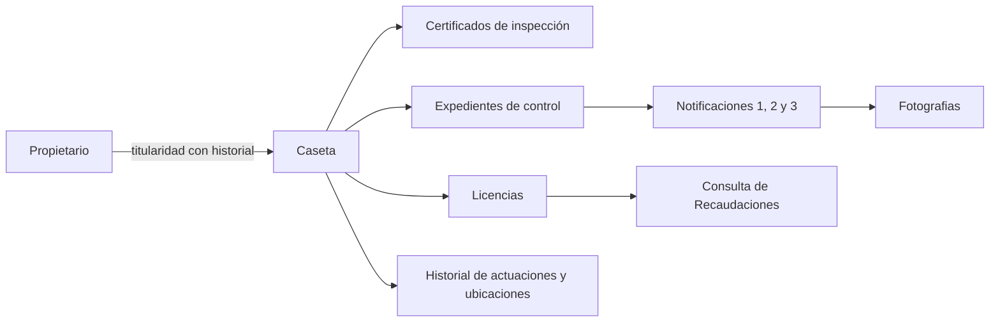

# Análisis y plan de modernización

Fecha: 23 de octubre de 2026.

Estado actualizado: alcance activo limitado a los puntos 1 al 6. El punto 7 y Recaudaciones están aplazados y desactivados en config/features.php, conservando sus datos y el código en reserva. El diagnóstico y el plan inicial siguientes se mantienen como referencia histórica; el alcance vigente se detalla en uso-casetas.md.

## 1. Punto de partida

El proyecto ya declara PHP 8.5.12 y Laravel 13. La siguiente etapa consiste en mejorar el modelo de información, el trabajo de campo y la interfaz. Se propone mantener Laravel y Blade y aprovechar las rutas, certificados, PDF y QR existentes.

La revisión se realizó sobre controladores, modelos, migraciones, vistas, rutas, dependencias y pruebas. No se consultó una base de producción ni se comprobó el funcionamiento en los teléfonos de los inspectores. El volumen, la calidad y las relaciones reales de los datos siguen pendientes de inventario.

El trabajo se realizará en las carpetas habituales del proyecto, sin crear otra distribución, una carpeta `dist` o scripts auxiliares de despliegue. La configuración de un entorno deberá conservarse fuera del control de versiones; este análisis no crea un `.env` local.

## 2. Diagnóstico inicial, previo a los cambios

### Información separada

- `app/Models/Certificate.php` representa certificados de inspección. No representa una licencia ni una caseta con identidad propia.
- `app/Notice.php` representa avisos independientes. No tiene relación con una caseta, un expediente de control o una secuencia de tres notificaciones.
- `database/migrations/2025_05_26_141007_create_notices.php:16` no define gestión, orden de aviso ni fecha de entrega efectiva.
- `app/Http/Controllers/CertificateController.php:27` utiliza todos los certificados como puntos del mapa de casetas. Repetir inspecciones podría producir varios puntos del mismo establecimiento.
- `app/Http/Controllers/CertificateController.php:77` exige un CI único entre certificados. Hay que revisar esta regla para permitir varios certificados históricos y varias casetas de un mismo propietario.

### GPS y fotografías

- `resources/views/notices/create.blade.php:157` ya solicita geolocalización de alta precisión. Activar esa opción nuevamente no resuelve por sí solo el problema.
- La vista dibuja un círculo fijo de 25 metros, no la precisión informada por el dispositivo. Ignora el error de geolocalización y puede conservar una ubicación inicial cuando falla la captura.
- Los certificados permiten seleccionar el punto en el mapa, pero no registran la fuente ni la precisión de la ubicación.
- `app/Http/Controllers/NoticeController.php:45` solo exige presencia de latitud y longitud; faltan validación numérica, rangos y confirmación de ubicación.
- La carga de fotografías ya valida contenido, tamaño y extensión y contempla limpieza si falla la transacción. Sigue realizándose al guardar el formulario. Falta previsualización y confirmación de carga previa al guardado.

### Estados, búsqueda y permisos

- `resources/views/notices/index.blade.php:43` calcula días absolutos desde cada aviso. Con la lógica actual, el estado vencido aparece desde las 72 horas; no corresponde al vencimiento solicitado de 48 horas después del tercer aviso.
- `app/Console/Kernel.php:25` no programa procesos de seguimiento.
- `app/Http/Controllers/NoticeController.php:24` filtra por tipo y carga toda la colección; no filtra por gestión y número en el servidor.
- Existen autenticación y una restricción específica para editar certificados. Todavía no existe la matriz Inspector / Asesor Legal / Jefe de Unidad en todos los módulos.
- Las cuentas web usan `App\User`; la autenticación de inspectores de la API usa `App\Models\Inspector`. Es necesario resolver la correspondencia de identidades sin igualar identificadores de tablas diferentes.
- El módulo `NotificationController` corresponde a otro flujo de avisos de la aplicación. Las mejoras de control de casetas corresponden principalmente a `NoticeController`; se debe conservar esta distinción al implementar.

### Interfaz y mantenimiento

- `package.json` conserva Laravel Mix 5, Bootstrap 4 y dependencias de esa etapa del proyecto.
- La interfaz carga AdminLTE y plugins desde `public/`; cambiar las dependencias de NPM por sí solo no actualizaría esas pantallas.
- Hay lógica de mapas y formularios repetida dentro de las vistas Blade y claves de mapas insertadas en varias plantillas. Deben centralizarse la configuración y las restricciones de uso del proveedor.
- `CertificateController::data()` utiliza `Certificate::all()` antes de construir el resultado de DataTables. La paginación debe trasladarse a la consulta para evitar cargar todos los registros en memoria.

## 3. Correcciones para la primera entrega

Estas correcciones deben preceder o acompañar la base del nuevo módulo:

1. **Conclusión técnica:** en `CertificateController.php:138` y `:232` se compara estrictamente el valor recibido con el entero `0`. Un formulario suele enviar la cadena `"0"`; normalizar y validar el booleano antes de generar una conclusión. Comprobar expresamente la respuesta «No».
2. **Resultado de retiro:** `resources/views/notices/show.blade.php:127` envía `type`, mientras `NoticeController.php:113` lee `retirement`. Corregir ambos extremos, conservar el estado pendiente y evitar un «Sí» seleccionado por defecto sin decisión del operador.
3. **Fechas y tipos:** la vista consulta `date2`, pero el dato se guarda como `presentation_date`. Añadir conversiones explícitas de fecha y booleanos para que formularios y listados muestren el valor almacenado.
4. **Coordenadas:** la edición de certificados repite la regla de `lng` y omite la de `lat`; el alta tampoco valida sus rangos. Diferenciar el centro visual del mapa de una ubicación confirmada.
5. **Autorización coherente:** utilizar la misma comprobación de permiso en botones y servidor. Algunas vistas todavía buscan la subcadena `ADMIN`, mientras el servidor ya exige el rol exacto.

Son hallazgos de lectura del código. La corrección deberá incluir pruebas de comportamiento y revisión de las pantallas afectadas.

## 4. Modelo de información propuesto

El elemento central será **Caseta**, con identidad independiente de sus certificados y notificaciones. Una caseta podrá registrarse sin licencia y sin certificado previo.

Datos mínimos:

- **Caseta:** identificador estable, número o código municipal, dirección, coordenadas, fuente de ubicación, precisión y fecha de captura; fecha de primer registro y estado operativo.
- **Propietario/titularidad:** nombre, documento y contacto, con fechas de vigencia de la relación para preservar cambios de propietario.
- **Licencia:** número, gestión, emisión, vencimiento, estado y procedencia de la verificación. Separar «sin licencia» de «pendiente de verificar» y de «licencia vencida».
- **Certificado:** conservar su contenido e identificadores actuales y añadir la relación con la caseta. El certificado acredita una inspección; no acredita automáticamente una licencia vigente.
- **Expediente de control:** motivo, apertura, estado, cierre y responsable. La secuencia de avisos pertenece a este expediente para no sumar notificaciones de procedimientos distintos.
- **Notificación:** número oficial como texto, gestión, orden 1/2/3, emisión, entrega si corresponde, observaciones, autor y adjuntos. El número oficial y el orden del aviso son conceptos diferentes.
- **Historial:** actuación, fecha, responsable, motivo y cambios relevantes. Conservar las coordenadas de cada actuación además de la ubicación actual de la caseta.
- **Adjunto:** archivo, propietario de la carga, relación con el registro y estado temporal o definitivo. Revisar el acceso a fotografías antes de incorporarlas al nuevo expediente.

Los documentos emitidos conservarán una copia de sus datos históricos: cambiar el propietario o la ubicación actual no debe reescribir un certificado anterior.

La migración será aditiva: incorporar tablas y relaciones opcionales, vincular registros verificados y revisar coincidencias ambiguas. No unir automáticamente registros solo porque coincidan el CI, la dirección o la cercanía GPS. Las migraciones históricas ya ejecutadas no se reescriben para introducir el nuevo modelo.

## 5. Reglas funcionales y criterios de aceptación

### GPS

Mostrar precisión estimada, instante de captura, estado del permiso y errores. Permitir reintentar y confirmar el punto; una corrección manual debe conservar su motivo y autor. Detener el seguimiento después de confirmar para evitar desplazar involuntariamente una caseta.

La precisión se expresará mediante `coords.accuracy`, en metros, y el círculo reflejará ese valor, conforme a la [documentación de geolocalización](https://developer.mozilla.org/en-US/docs/Web/API/GeolocationCoordinates/accuracy). HTTPS y permisos del dispositivo forman parte de la validación de campo.

**Aceptación:** un permiso denegado, una respuesta antigua o una captura fallida no guardan silenciosamente el centro predeterminado como ubicación real. Los valores fuera de rango se rechazan. El umbral de precisión aceptable se define tras un piloto con los teléfonos utilizados; no se promete exactitud absoluta.

### Fotografías

Captura o selección con previsualización inmediata; carga temporal vinculada al usuario, progreso, confirmación y reintento. Al guardar, el servidor verifica el adjunto y lo asocia al registro dentro de una transacción. Limpiar cargas temporales abandonadas según una política de conservación definida.

**Aceptación:** distinguir «imagen visible en el teléfono» de «imagen almacenada». Un reintento no duplica avisos ni adjuntos. Un usuario no puede apropiarse de la carga temporal de otro. Mantener las validaciones de contenido ya incorporadas. El trabajo completamente sin conexión se evalúa como ampliación posterior.

### Licencias, avisos y vencimiento

Conservar las reglas solicitadas: licencia vigente en blanco; primera notificación amarilla; segunda azul; tercera verde con número 3; vencimiento de la tercera a las 48 horas en rojo; falta de licencia o pendiente de retiro identificados en rojo y declaración de falta de licencia con X.

Representar por separado y simultáneamente los dos estados que describen las notas: el estado de licencia de la caseta (blanco o rojo) y la etapa de notificación (amarillo, azul, verde con 3, o rojo al vencer). Como solución de interfaz, el marcador puede llevar el color de licencia y un distintivo de etapa dentro de él, conservando el 3 visible y la X cuando el propietario declare no tener licencia. Esta composición es una propuesta de presentación para mostrar ambas reglas; las notas no establecen que un estado deba ocultar al otro. Una situación sin verificar no se clasificará automáticamente como «sin licencia».

Aplicar el plazo indicado: cambio automático a rojo al cumplirse 48 horas desde la fecha y hora registradas de la tercera notificación. No añadir un plazo de días hábiles ni exigir una fecha adicional de entrega como disparador del vencimiento. Calcularlo en el servidor, guardar instantes en UTC y mostrar hora local de Bolivia, revisando antes cómo están almacenadas las fechas antiguas. El estado al consultar debe reflejar el vencimiento aunque no se haya ejecutado el programador; el proceso programado registra el evento una sola vez. La pantalla se actualiza periódicamente.

**Aceptación:** secuencia sin duplicados incluso con peticiones simultáneas; pruebas inmediatamente antes, exactamente al cumplir y después del plazo. No usar diferencias absolutas de días ni el reloj del teléfono. El rojo identifica un caso para seguimiento: el retiro o sanción requiere una actuación autorizada y registrada.

### Búsqueda por gestión

Buscar por número oficial y gestión, con filtros y paginación del servidor. Conservar ceros iniciales. Definir si la unicidad del número depende también del tipo de aviso o de la unidad emisora antes de crear una restricción.

**Aceptación:** el número `0012` de una gestión no devuelve registros de otra. Los datos históricos sin gestión verificada se identifican para revisión. Las búsquedas y el mapa aplican los mismos permisos.

### Perfiles

- **Inspector-Notificador:** registrar casetas, ubicaciones, fotografías, inspecciones y notificaciones dentro del ámbito autorizado.
- **Asesor Legal:** consulta de módulos y expedientes. No se presupone permiso de escritura por el hecho de poder consultarlos.
- **Jefe de Unidad:** administración, supervisión, consulta y reportes; correcciones sensibles con trazabilidad.

Aplicar [políticas de autorización de Laravel](https://laravel.com/framework/docs/13.x/authorization) por recurso y acción en web y API. Antes de activar restricciones, inventariar las cuentas y mapear los roles existentes para conservar un administrador operativo. No incorporar nombres ni documentos personales al código.

**Aceptación:** una cuenta de consulta no modifica datos mediante una petición directa; un inspector no administra usuarios; el jefe accede a los reportes autorizados. La desactivación de una cuenta debe impedir también el uso de sus sesiones o tokens según el mecanismo correspondiente.

### Mapa y ficha única

Un punto por caseta; certificados y avisos consultan la misma ubicación de referencia. Filtros por licencia, etapa de notificación, vencimiento y gestión; leyenda con texto y símbolos además del color. Cargar por zona visible y agrupar puntos cuando el volumen lo requiera.

Al seleccionar una caseta, mostrar resumen y acceso a la ficha con propietario, contacto, licencia, certificados, fotografías e historial cronológico. Una ubicación nueva o corregida debe quedar registrada en el historial.

**Aceptación:** varias inspecciones de una misma caseta no generan varios puntos; las casetas sin certificado pueden aparecer; mapa, ficha y listado muestran el mismo estado. Los datos personales permanecen en vistas autorizadas.

### Recaudaciones

Primero identificar el sistema responsable, el identificador de enlace, el acceso disponible y el significado de cada estado. Proponer consulta de solo lectura mediante API o importación controlada si no existe API. Mostrar fuente y fecha de última verificación.

**Aceptación:** un servicio externo caído produce «no se pudo verificar», no «impago» ni «sin licencia». El estado de pago y la vigencia de la licencia se muestran por separado. Esta integración no debe bloquear los registros de campo.

## 6. Modernización de interfaz y código

1. Mantener Blade e introducir componentes compartidos para formularios, filtros, estados, fotografías y mapas.
2. Preparar una pantalla piloto móvil: búsqueda, caseta, captura GPS/foto y confirmación. Priorizar botones accesibles, errores claros y conservación de los campos cuando falla el guardado.
3. Migrar la compilación de recursos de Mix a [Vite con la integración de Laravel 13](https://laravel.com/framework/docs/13.x/vite). Inventariar antes los CSS y JS realmente utilizados, incluidos los copiados en `public/`.
4. Actualizar el tema y sus componentes de forma conjunta. Comprobar tablas, ventanas, fechas, navegación e impresión; no mezclar versiones incompatibles de Bootstrap y AdminLTE.
5. Extraer JavaScript repetido de las vistas y centralizar configuración de mapas. Mantener inicialmente el proveedor existente; cambiar de proveedor requeriría evaluar cobertura, condiciones y coste.
6. Separar validaciones en Form Requests y reglas de estados en servicios o acciones. Usar consultas paginadas, relaciones e índices ajustados a las búsquedas reales.
7. Renovar navegación y panel: Casetas, Mapa, Inspecciones/Certificados, Notificaciones y Reportes. Mostrar contadores con el mismo filtro y cálculo que los listados.

El servidor seguirá sirviendo la carpeta `public/` del proyecto. La compilación de recursos no requiere entregar una aplicación separada ni una carpeta `dist`.

## 7. Orden de implementación

### Entrega 1: correcciones y definición de la base

Corregir los fallos de conclusión técnica, retiro, fechas, coordenadas y permisos de interfaz; añadir sus pruebas. Definir Caseta, perfiles y relaciones, y preparar las migraciones aditivas. Confirmar motor y versión de la base de datos de destino sin solicitar credenciales en el chat.

**Salida verificable:** las respuestas «Sí/No/Pendiente» persisten correctamente, las coordenadas inválidas se rechazan y el esquema nuevo puede ensayarse en una copia sin alterar documentos existentes.

### Entrega 2: casetas y ficha histórica

Crear el registro de casetas, propietarios, licencias e historial; relacionar certificados y avisos. Incorporar revisión de registros pendientes de vincular y activar los permisos del módulo. Ensayar la migración y reconciliar cantidades y asociaciones en una copia de la base real.

**Salida verificable:** registrar una caseta sin licencia, asociar varios documentos a ella y consultar su historial sin duplicar el punto ni modificar documentos anteriores.

### Entrega 3: trabajo de campo e interfaz piloto

Implementar GPS confirmado, precisión y errores, carga temporal de fotos y previsualización, reintentos y formulario móvil. Introducir componentes y recursos compartidos para extenderlos después al resto de pantallas.

**Salida verificable:** un inspector completa el flujo desde un teléfono, recupera errores de conexión y obtiene confirmación de fotografía y ubicación.

### Entrega 4: procedimiento de notificaciones

Incorporar expedientes, secuencia 1/2/3, plazo de 48 horas después de la tercera notificación, seguimiento y búsqueda por número/gestión. La constancia de entrega, si se incorpora, será información complementaria. Resolver anulación, regularización y cierre antes de activar vencimientos en datos históricos.

**Salida verificable:** secuencia y vencimiento correctos, búsqueda sin mezclar gestiones e historial de cambios con responsable.

### Entrega 5: mapa unificado y extensión visual

Conectar mapa, filtros, ficha y contadores con las reglas centrales. Aplicar la interfaz validada a los módulos restantes y optimizar consultas y carga de puntos con un conjunto representativo de datos.

**Salida verificable:** una caseta tiene una sola representación y los estados coinciden entre pantallas; navegación usable en móvil y escritorio; certificados PDF y QR siguen funcionando.

### Entrega 6: Recaudaciones, piloto y puesta en servicio

Integrar consultas externas cuando exista acceso y correspondencia de datos. Validar con inspectores, asesoría y jefatura. Ensayar respaldo/restauración de base y adjuntos, despliegue, tareas programadas y recuperación antes de activar los cambios.

**Salida verificable:** operación de campo sin depender del servicio externo, datos reconciliados y procedimiento de recuperación comprobado. La fecha de esta entrega depende del acceso a Recaudaciones y de la revisión de datos.

## 8. Pruebas y paso a producción

Las pruebas existentes cubren compatibilidad del framework, autenticación, algunas restricciones y carga segura de fotos. La prueba `test_notice_deadlines_retain_whole_absolute_days_after_carbon_upgrade` conserva expresamente el comportamiento anterior; deberá actualizarse junto con la nueva regla, no interpretarse como validación de las 48 horas solicitadas.

Añadir pruebas de permisos por perfil, secuencia y concurrencia, límites temporales, número/gestión, casetas sin certificado, historial, adjuntos temporales y conservación de documentos. Verificar las nuevas migraciones sobre el motor de destino; SQLite no basta para comprobar diferencias de PostgreSQL.

Realizar pruebas reales en teléfonos para permisos GPS, precisión, cámara, interrupciones de red y recuperación del formulario. Mantener una revisión de PDF, QR y módulos ajenos a casetas.

Aplicar por etapas: esquema compatible, migración de datos verificados, activación del módulo y comprobación de cantidades y relaciones. Ante un fallo, desactivar el flujo nuevo conservando los datos; no eliminar tablas con trabajo capturado como forma de volver atrás. Una restauración completa exige conservar y reconciliar las actuaciones posteriores al respaldo.

El análisis inicial fue estático. Después se implementaron cambios y se verificaron mediante pruebas y vista previa aislada; consultar uso-casetas.md. No se migró una base de producción.

## 9. Reglas de las notas y aspectos operativos restantes

El usuario indicó seguir las notas tanto para los colores como para el plazo. Se mantienen primera notificación amarilla, segunda azul, tercera verde con 3 visible, rojo a las 48 horas después de la tercera, licencia vigente blanca, sin licencia o pendiente de retiro roja y X ante declaración de no contar con licencia. Estas reglas ya no quedan pendientes de una elección entre alternativas propuestas durante el análisis.

Las notas no detallan los siguientes aspectos, que deberán recogerse del procedimiento existente al implementar:

1. Intervalos y requisitos entre avisos; cuándo se cierra, anula o reinicia un procedimiento por regularización, corrección o cambio de gestión.
2. Serie oficial del número de notificación y alcance de su unicidad; numeración de casetas y posibilidad de titularidad de varias casetas.
3. Motor/versión de la base real, volumen de registros, calidad de coordenadas y correspondencia de cuentas web e inspectores.
4. Acceso técnico a Recaudaciones e identificador común para vincular licencias y pagos.

Antes de activar vencimientos en registros antiguos, verificar su asociación a una caseta y a la tercera notificación del procedimiento correspondiente. Las correcciones iniciales, el inventario y la preparación del modelo pueden avanzar de forma independiente.
